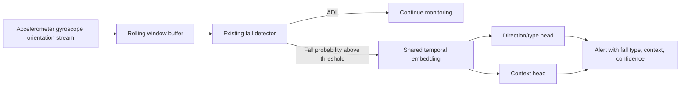

# Real-Time Fall Type and Context Architecture

## 1. Objective

The existing system detects whether a sensor window is `ADL` or `Fall`. The
next stage should describe a confirmed fall without running two more heavy
models sequentially.

The engineering objective is:

```text
one fall-detection pass + one cheap shared feature pass
    -> direction/type prediction + context prediction
```

The additional classifiers should run on the representation already produced
by the detector whenever possible. A practical target for an edge laptop is
less than 100 ms of additional classifier time after the fall decision, while
the full end-to-end latency should be measured separately.

## 2. Recommended architecture

Use a **shared multi-task architecture**:

1. Keep the existing fall detector as the first-stage binary detector.
2. Expose its final temporal embedding before the binary output layer.
3. Add two small classification heads to that embedding:
   - `direction_head`: forward, backward, left/lateral, right/lateral,
     sitting/collapse, or unspecified.
   - `context_head`: standing, walking, stairs, obstacle, height, or
     unspecified, depending on the labels actually available.
4. Run the heads together in one forward pass only after the detector reaches
   the fall threshold.
5. Emit the type/context result with the alert, including confidence and an
   `unknown` option when confidence is low.



For the current ConvLSTM baseline, the reusable embedding is the final LSTM
representation (`out[:, -1, :]`) before the binary fully connected layer. The
new heads can initially be trained while the existing backbone is frozen. The
backbone can then be fine-tuned cautiously if the type heads need more signal.

## 3. Why this is preferred

It avoids three expensive sequential inferences. The detector and the two
heads share convolutional and temporal computation. The heads are only small
linear or two-layer MLP layers, so their cost is normally negligible compared
with the existing detector.

The current Random Forest remains useful as a fast benchmark and for feature
analysis, but the current script extracts impact-aligned trial features and
evaluates cross-validation. It does not yet form a deployed real-time second
stage. A real-time version would need a streaming feature extractor and saved
models trained on the same feature schema.

## 4. Input and feature design

### 4.1 Features reused from the detector

Prefer the detector's embedding first. It already summarizes the recent motion
window and requires no second pass over the sensor stream.

### 4.2 Low-cost inertial features

Use only the available accelerometer, gyroscope, and orientation streams. Add a
small engineered feature vector rather than a second large network:

- Acceleration magnitude and per-axis peaks.
- Gyroscope magnitude and per-axis peaks.
- Peak timing relative to onset and impact.
- Signal energy, variance, median absolute value, and jerk.
- Motion-direction proxies in the calibrated sensor coordinate frame.
- Body tilt, orientation change, and final orientation.
- Dominant acceleration and rotation direction.
- Duration from fall onset to impact.
- Pre-event baseline and change from that baseline.
- Left/right or forward/backward asymmetry where the sensor is body-calibrated.

These features can support direction/type and activity context. They cannot
directly observe an obstacle, stairs, or the physical height of a fall.

### 4.3 Sensor-only context limits

With inertial data only, context labels must describe motion patterns that the
sensors can measure, such as standing, walking, running, sitting/collapse, or
fainting-like loss of posture. Stairs or obstacle-related classes should be
used only when those events create a distinct and consistently labeled inertial
signature.

Do not claim that a sensor-only model has identified an obstacle, stairs, or a
fall from a height unless the dataset contains a validated sensor signature for
that class. Return `unknown` when the signal does not support the distinction.

## 5. Model choices and alternatives

| Approach | Input | Additional latency | Accuracy/training trade-off | Reuses detector? | Deployment fit |
|---|---|---:|---|---|---|
| Shared multi-task heads (recommended) | Existing embedding, optional kinematic vector | Usually under 1-10 ms for heads | Best efficiency; needs multi-label fall data | Yes | Excellent |
| Random Forest/XGBoost on streaming features | Peaks, trajectory proxies, inertial statistics | Usually under 1-20 ms on a laptop | Strong baseline on tabular data; needs feature extraction and fixed schema | Indirectly | Excellent |
| Small GRU/TCN on embedding sequence | Short embedding sequence | Roughly 5-40 ms after optimization | Better temporal modeling; more training and tuning | Yes | Good |
| Separate lightweight sensor model | Raw inertial window | About 5-50 ms depending on model/device | Can improve temporal modeling but duplicates sensor processing | Possibly | Good if very small |
| Separate CNN/LSTM per task | Raw sensor windows | Commonly 100-300 ms each | Potentially accurate but duplicates computation | Usually no | Poor sequentially |
| Rule-based kinematic classifier | Thresholds on tilt, height, velocity | Usually below 1 ms | Very fast and interpretable; brittle across cameras and people | Uses detector signals | Good as fallback |
| Early-exit/cascade | Detector intermediate features | Low average cost; higher worst case | Useful when most events are easy; more complex calibration | Yes | Good if profiled |

SVM is reasonable for a small, normalized feature vector, but Random Forest or
gradient-boosted trees are easier to maintain with mixed features and missing
values. Do not use a separate SVM/RF for every sensor frame; classify one
confirmed event window and smooth the result.

## 6. Exact model recommendation

### Stage 1: existing detector

Keep the current ConvLSTM, SVM, or selected production detector for binary
`ADL/Fall` prediction. The production choice should be based on measured
accuracy-latency results on the target laptop/edge hardware.

### Stage 2: shared multi-task classifier

Start with:

```text
detector embedding
    -> LayerNorm or standardization
    -> small shared MLP: 128 -> 64
    -> direction head: 64 -> number_of_direction_classes
    -> context head: 64 -> number_of_context_classes
```

For a detector that exposes only one final embedding, two independent linear
heads may be enough. Add the MLP only if validation shows that the embedding is
not linearly separable.

For a strong non-DL baseline, concatenate the embedding with engineered
features and train two `RandomForestClassifier` or XGBoost classifiers. Fit
one model for direction and one for context. Use subject-grouped splits, class
weights, and an explicit unknown/reject threshold.

## 7. Training strategy

1. Keep the existing binary detector and its subject split unchanged.
2. For every fall trial, create direction and context labels from the label
   workbook, then review ambiguous descriptions manually.
3. Run the detector over each training window and save the embedding, not just
   the binary output.
4. Train the direction and context heads using only fall examples. ADL windows
   do not receive fall-type labels.
5. Freeze the detector first and train the heads.
6. Validate on unseen subjects using the same subject-grouped split.
7. Optionally fine-tune the last detector block with a small learning rate and
   a combined loss:

```text
loss = binary_loss + lambda_direction * direction_loss
     + lambda_context * context_loss
```

8. Calibrate probabilities and reject low-confidence predictions as
   `unknown`.
9. Export the detector plus heads to ONNX or TorchScript only after measuring
   accuracy and latency on the deployment device.

The current event-aligned Random Forest analysis can be used as a baseline. Its
labels are task-level categories derived from descriptions, so new deployment
labels must match the intended real-world definitions rather than blindly
reusing ambiguous task names.

## 8. Dataset requirements

Each fall event should have one event-level record containing:

| Field | Requirement |
|---|---|
| Subject ID | Used for group splits; never leak across train/test |
| Event/trial ID | Links all windows, labels, and predictions |
| Onset and impact time | Enables aligned temporal features |
| Binary label | ADL or fall |
| Direction/type | Mutually exclusive primary fall type, or a documented multi-label scheme |
| Context | Standing, walking, stairs, obstacle, height, etc. |
| Visibility/quality | Sensor quality, missing channels, calibration status |
| Environment metadata | Stairs, obstacle, floor type, height, camera setup |

Collect enough examples for every target class across subjects, sensor
placements, body sizes, speeds, and fall mechanisms. Split by subject and
preferably by recording session or environment as well. Include hard negatives
such as fast sitting, kneeling, lying down, and dropped objects.

The proposed context taxonomy must be fixed before training. `Walking` and
`stairs` describe activity/environment, while `fall from height` describes a
different physical situation. If labels overlap, use a multi-label context
head or define a hierarchy instead of forcing one arbitrary class.

## 9. Latency strategy

- Share the detector backbone and expose its embedding.
- Trigger type/context inference only after a fall candidate, not on every
  frame.
- Keep a rolling buffer so the detector window is already available.
- Run the two heads in one batched forward pass.
- Use FP16 or INT8 quantization where supported.
- Export with ONNX Runtime, TensorRT, or the platform's optimized runtime after
  profiling; do not assume the framework default is fastest.
- Keep sensor preprocessing fixed and avoid recalculating features already
   produced by the detector.
- Cache features and avoid decoding or preprocessing the same frames twice.
- Use asynchronous capture, inference, and alert delivery.
- Apply event-level temporal smoothing instead of repeatedly running models
  after the event is already confirmed.
- Measure p50 and p95 latency, not only the average.

Parallel execution of two separate models can reduce wall-clock time, but it
still consumes two model loads and usually duplicates preprocessing. Shared
heads are preferable. Use parallelism only when profiling shows that separate
sensor processing is unavoidable without exhausting CPU, memory, or thermal
limits.

## 10. Evaluation

Report separately for direction and context:

- Macro and weighted precision, recall, and F1-score.
- Balanced accuracy and per-class recall.
- Confusion matrix.
- Calibration error and confidence-rejection coverage.
- Performance on unseen subjects and unseen environments.
- Binary detector sensitivity/specificity and type-classification performance
  conditioned on a correctly detected fall.
- End-to-end alert latency from impact or detector trigger.
- Additional classifier latency: p50, p95, and worst observed value.
- Throughput/FPS, CPU/GPU utilization, memory, and power where relevant.

Do not evaluate type classification only on randomly split windows. Windows
from the same event or subject must not cross train/test boundaries.

## 11. Practical implementation plan

### Phase 1: establish the baseline

1. Select the current production binary sensor detector.
2. Add a hook that saves its final embedding and event timestamps.
3. Confirm that the embedding is produced without a second sensor pass.
4. Measure detector latency and memory on the target device.

### Phase 2: train the cheap heads

1. Finalize direction and context taxonomies.
2. Audit and correct task-description labels.
3. Train two small heads on frozen embeddings.
4. Evaluate with subject-grouped and environment-aware splits.
5. Add an unknown/reject output and probability calibration.

### Phase 3: resolve sensor-only context limits

1. Check errors for obstacle, stairs, and height classes.
2. Remove or merge classes that cannot be distinguished from inertial signals.
3. Add an `unknown` class or confidence rejection for unsupported contexts.
4. Retrain only the heads first; fine-tune the backbone only if necessary.

### Phase 4: deploy and profile

1. Export the complete pipeline to the chosen optimized runtime.
2. Profile p50/p95 latency, FPS, and resource use on the real device.
3. Test difficult negatives, sensor-placement changes, calibration drift, and
   delayed alerts.
4. Gate type/context output on a confirmed fall and low-confidence rejection.

## Final recommendation

Build the shared multi-task heads first. Reuse the existing sensor detector
embedding, train one small head for direction and one for context, and use the
current Random Forest as a fast inertial-feature baseline and error-analysis
tool. Restrict context labels to classes supported by accelerometer, gyroscope,
and orientation signals, and return `unknown` for unsupported environmental
claims. This gives the lowest additional latency without adding another sensor
processing model.